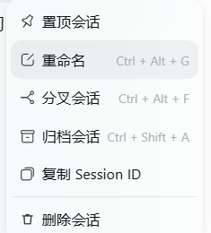

# dsh-session-delete

[](LICENSE)
[](https://nodejs.org)

[English](README.md) | 中文

给 **DeepSeek Harness**（DSH）的侧栏会话行加一条真正管用的「删除会话」。确认后它会把该会话——**连同它派生出的所有子智能体会话**——的日志目录、投影缓存，以及工作区里的会话记账一起清掉，而不是只在界面上隐藏。

DSH 自带的「归档」只是把会话从列表里挪走，`~/.dsh/sessions/` 里的记录原封不动。想在本地真正抹掉一个会话时，缺的就是这个动作。



## 目录

- [它到底删什么](#它到底删什么)
- [它刻意不碰什么](#它刻意不碰什么)
- [安装](#安装)
- [使用](#使用)
- [命令行工具](#命令行工具)
- [工作原理](#工作原理)
- [兼容性](#兼容性)
- [排错](#排错)
- [开发](#开发)
- [许可](#许可)

## 它到底删什么

一次删除只动三处，全部位于 `$DSH_HOME`（默认 `~/.dsh`）内：

| 位置 | 内容 |
| --- | --- |
| `sessions/<项目键>/<会话段>/` | 该会话（含全部子会话）的日志目录，通常只有一个 `session.v4.jsonl.zstd` |
| `storages/session_projcache/sessions/<id>.json` | 该会话的投影缓存，含 `session-` 前缀与无前缀两种历史拼写 |
| `storages/workspace.json` | 把 id 从 `sessionIds`、`archivedSessionIds`、`pinnedSessionIds` 里摘掉 |

子会话的收集依据是持久化头与活跃会话头上的 `parentSession` 字段，与界面里的折叠状态无关。删除顺序是「先停活 → 再删盘 → 最后摘记账」：反过来的话，正在运行的回合会在删除过程中把状态写回磁盘。

## 它刻意不碰什么

- **工作区目录本身**及其中的任何文件。你的代码、笔记、构建产物一个字节都不会动。
- **`attachments/` 内容寻址仓库**。同一张图可能被别的会话引用，删掉会连带弄坏别人。
- **其他会话的任何数据。**
- **`workspace.json` 里的工作区记录**。工作区还在，只是少了这个会话。

## 安装

### 从 GitHub 安装（推荐）

在 DSH 的侧栏打开 **插件**页，选择从 Git 地址安装：

```
https://github.com/DreamStars168/dsh-session-delete.git
```

或者直接写进 profile 的 `package.json`：

```json
{
  "dependencies": {
    "dsh-session-delete": "github:DreamStars168/dsh-session-delete"
  },
  "dsh": {
    "profile": {
      "bundles": ["@deepseek-ai/dsh-base", "@deepseek-ai/dsh-web-app", "dsh-session-delete"]
    }
  }
}
```

### 从源码目录安装（本地开发）

```bash
git clone https://github.com/DreamStars168/dsh-session-delete.git
cd dsh-session-delete
```

然后把绝对路径写进 profile：

```json
{ "dependencies": { "dsh-session-delete": "file:/绝对路径/dsh-session-delete" } }
```

### 生效

- **客户端**（`client.js`）刷新页面即可，`dsh-client-hmr` 会轮询到变更。
- **宿主侧**（`lib/`）改的是服务装配，需要重启 DSH。

## 使用

1. 在侧栏找到目标会话。
2. 点该行的 **「…」** 按钮，或直接在行上 **右键** —— 右键弹出的是同一个原生菜单。
3. 选 **删除会话**。
4. 确认弹窗里点 **删除**。

新条目排在「复制 Session ID」之后的独立分区里。

如果删的是你当前正在看的会话，主视图会自动在原工作区新开一个空会话，聊天框不会挂在已被删掉的记录上。

清理过程中若有单项失败（比如某个缓存文件被占用），会话仍然会被移除，界面提示「会话记录已移除，但有 N 项未能清理」，失败的条目打在控制台里，方便逐项排查。

## 命令行工具

宿主没启动时——比如你想在启动前先把某个会话清掉——用附带的 CLI：

```bash
# 预演：只列路径与记账命中，不改任何文件
node bin/dsh-session-delete.js session-abc123

# 真删（先把 workspace.json 备份到 _trash/session-delete-<时间戳>/）
node bin/dsh-session-delete.js session-abc123 --apply

# 只删磁盘、保留 workspace.json 里的记账
node bin/dsh-session-delete.js session-abc123 --apply --keep-workspace

# 列出磁盘上所有会话目录
node bin/dsh-session-delete.js --list
```

选项：`--dsh-home <dir>` 指定主目录，`--json` 机器可读输出，`-h` 帮助。

预演是默认行为，这很重要：`--apply` 之前的每一步都能反悔，加上之后不能。

## 工作原理

插件由两半组成，都从 `package.json` 的 `dsh` 字段声明：

**Host 半侧**（`lib/`）注册一个具名 HTTP 路由 `POST /session-delete/api`，请求体是 `{ "op": "delete", "sessionId": "…" }`。删盘逻辑不依赖任何官方 npm 包——所有宿主能力都经 Cordis 的服务对象软取，取不到就走纯文件系统兜底，因此 profile 里解析不到官方 `node_modules` 也能跑。

路由入口有两道闸：只收 POST；只认同源与回环请求（对端回环，或 Host 指向 localhost 且 Origin 缺省 / 为 `null` / 为 `app:` / 同源）。其余一律 403，避免任意网页用 CSRF 触发删盘。

**浏览器半侧**（`client.js`）往 `sidebar.workspaces.session.menu.item` 槽位注册菜单项，往 `shell.overlay` 注册确认弹窗。右键菜单不另造副本——它找到该行行尾的省略号按钮，合成一次 `click()`，让宿主自己的 `Menu` 组件展开。条目、快捷键、分隔线、权限判断全部是原生那份，不会随宿主升级而漂移。

```
client.js                    菜单项 + 确认弹窗 + 右键转发
  └─ POST /session-delete/api
       └─ lib/server.js      HTTP 闸门与错误映射
            └─ lib/delete.js 停活 → 删盘 → 摘记账
                 └─ lib/paths.js 路径编码（与官方持久化后端同源）
```

## 兼容性

- Node.js ≥ 18（用到 `node:test`、`fs.rmSync`）。
- DSH ≥ 0.2.0。宿主侧只依赖 `webServer` 服务；`sessionPersistence`、`sessions`、`agents`、`workspaceRegistry` 全部软取，缺了不会让路由挂掉，只是对应步骤跳过。
- 桌面端与 Web 端都可用。桌面端走 `app:` 来源判定。

路径编码（`encodeSegment` / `projectKey`）是从官方持久化后端同名函数推导的**同源实现**，不是 import —— 这样插件在没有官方 `node_modules` 的环境里也能算回同一个目录。宿主升级若改变了命名规则，插件会在拿不到 `locate()` 时算错目录；此时优先依赖后端 `locate()`，或提 issue。

## 排错

**菜单里没有「删除会话」**

先确认插件真的加载了：侧栏 **插件**页里 `dsh-session-delete` 应为启用状态。若刚改过 `lib/`，需要重启 DSH，仅刷新页面不够。

**点了删除，提示失败**

打开开发者工具看 Network 面板里 `/session-delete/api` 的响应体，`errors` 数组会逐条列出失败的路径与原因。常见原因是文件被另一个进程占用——关掉那个进程后重试。

**删除后会话又出现了**

几乎都是宿主进程里还留着活跃句柄，重启 DSH 后应消失。若仍然存在，说明记账没摘干净：用 CLI 的 `--list` 确认磁盘状态，再对残留 id 跑一次 `--apply`。

**想先看看会删什么**

永远先跑不带 `--apply` 的 CLI。它是纯预演，一个字节都不改。

## 开发

```bash
npm run check   # 语法 + 清单自检 + 隐私/密钥扫描
npm test        # 46 项单测，全部在临时目录里跑
```

测试分四组：路径编码（`test/paths.test.js`）、删除主流程（`test/delete.test.js`）、HTTP 闸门（`test/server.test.js`）、CLI（`test/cli.test.js`）。所有用例都在 `mkdtempSync` 造出的临时目录里跑，不会碰你真实的 `~/.dsh`。

`npm run check` 里带一道隐私扫描：本机用户目录绝对路径、API Key、私钥、GitHub token、AWS Access Key 命中即失败。提交前跑一次，能挡住绝大多数误传。

## 许可

[MIT](LICENSE)
